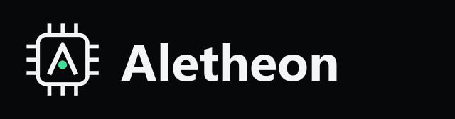
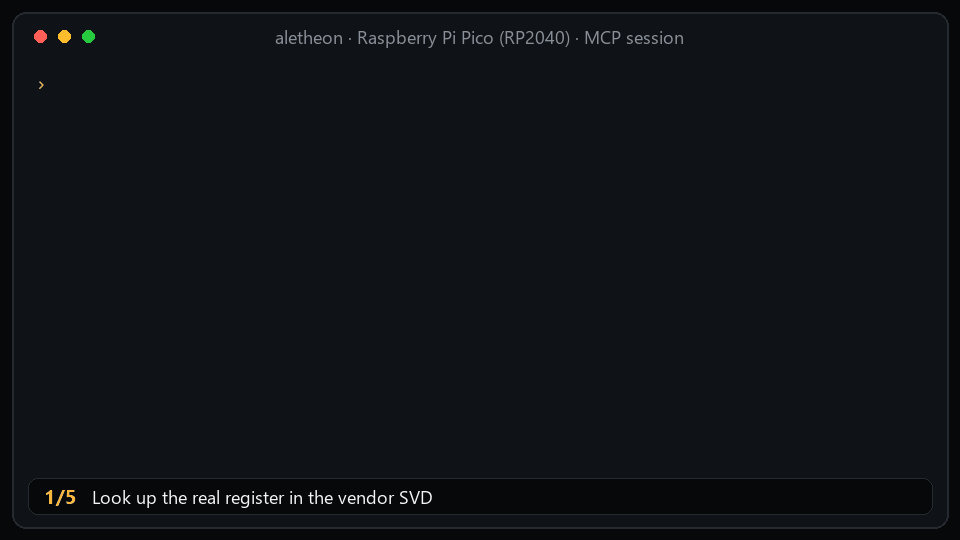

<p align="center">
  
</p>

<h3 align="center">Firmware AI that shows its evidence.</h3>

<p align="center">
  <a href="https://github.com/denishkarnati/aletheon/actions/workflows/ci.yml"></a>
  
  
  <a href="https://github.com/denishkarnati/Aletheon/actions/workflows/codeql.yml"></a>
  <a href="https://denishkarnati.github.io/Aletheon/">Website</a> ·
  <a href="docs/HANDBOOK.md">Handbook</a> ·
  <a href="examples/">Examples</a> ·
  <a href="evidence/REPORT.md">Test evidence</a> ·
  <a href="SECURITY.md">Security</a>
</p>

Aletheon (from the Greek *aletheia*, "truth") is an AI firmware engineer for **VS Code** and **any MCP-capable agent**. It reads your datasheets and
CMSIS register maps, and it audits its own answers: every register address, voltage or timing it states must cite evidence that actually contains
that value. If it cannot prove a claim, it says `UNVERIFIED`.

> **Status: alpha.** Register-map tooling is tested against real vendor files (see [Measured](#measured)). It has **not** been run on real boards yet,
> and **no real LLM has been scored** on the benchmark yet. The numbers below are exactly what was measured, no more.

## See it work
<p align="center"></p>

Real output from the shipped tools on RP2040 files. The answer audited in the last step is wrong on purpose.

## Why
Models invent registers, use peripherals your chip does not have, and cite sources that do not say what they claim. A wrong address does not raise an
error; it writes to the wrong place. Aletheon makes the evidence the product:

- **Evidence ledger**: every tool result is an `[E#]` entry with source, SHA-256 of the exact file, and a **trust class** (`measured`, `vendor-official`, `derived`, `user-supplied`, `community-mirror`).
- **Register ground truth**: addresses, offsets, resets and bit fields come from **CMSIS-SVD**, not model memory; datasheet passages are searched with page numbers (keyword + optional semantic).
- **Claim audit**: each hardware value must cite an entry whose text contains it. Uncited values, invented ids and "citation laundering" are flagged.
- **Cross-check**: SVD vs datasheet disagreements are surfaced, not silently resolved.
- **Driver workflow**: generates a C register header straight from the SVD (with layout asserts), compiles it, then builds and (with approval) flashes and captures serial output.
- **Local-first**: documents, vectors and the ledger stay in `<project>/.aletheon/`. No telemetry. Bring your own model: Claude, any OpenAI-compatible endpoint, or Ollama.

## Install
**VS Code and compatible editors**: download the `.vsix` from [Releases](https://github.com/denishkarnati/aletheon/releases), then
```bash
code --install-extension aletheon-0.1.0.vsix
```
Run *Aletheon: Set AI Provider API Key*, pick a board in the status bar, open the Aletheon view.

**Any MCP client**
```bash
git clone https://github.com/denishkarnati/aletheon && cd aletheon
npm install && npm run build
```
```json
{ "mcpServers": { "aletheon": {
    "command": "node", "args": ["/path/to/aletheon/dist/mcp.js"],
    "env": { "ALETHEON_ROOT": "/path/to/your/firmware", "ALETHEON_BOARD": "rpi-pico" } } } }
```
You also need your own toolchain (PlatformIO, `arduino-cli`, or ESP-IDF). Full guide, settings and troubleshooting: **[docs/USAGE.md](docs/USAGE.md)**.

## Five things to try
No AI key needed to see it work: `npm install && npm run build && pip install ziglang && npm run examples -- rp2040`, then read
[the transcript](examples/rp2040-uart-driver/TRANSCRIPT.md) (register lookup, cross-check, header generation, a driver cross-compiled for Cortex-M0+, claim audits).

1. **Ask a register question with proof**: *"Address, reset value and BUSY bit of UART0 UARTFR on the Pico? Cite evidence."*
2. **Bring up a driver**: *Aletheon: Generate Driver (SVD-grounded)*.
3. **Audit any text**: `audit_claims` (MCP `ground_check`).
4. **Check a register map against its datasheet**: `cross_check_register`.
5. **Score any assistant**: `npm run bench:grounding -- --list`, then `-- answers.json`.

## Measured
Every row is reproduced by `npm run evidence`; the raw logs and their SHA-256 hashes are in [evidence/](evidence/REPORT.md).

| What | Result | Log |
|---|---|---|
| Generated register headers (RP2040, STM32F401, nRF52840, ESP32-S3) compiled with clang `-Wall -Werror` | **210 / 210** clean as C11; per-device C++17 builds clean, and the three ARM devices build clean for thumb targets | [headers-compile](evidence/logs/headers-compile.log) |
| SVD vs datasheet cross-check, 91 real RP2040 registers | **87 agree**, 1 false conflict, 1 name-only, 2 not-found | [audit](evidence/logs/audit.log) |
| Same check with every offset shifted by 0x40 | **0 agree**, 88 flagged as conflict | [audit](evidence/logs/audit.log) |
| Datasheet search, keyword only, 12 paraphrased questions | hit@1 **4/12**, hit@5 **7/12** (baseline for semantic search) | [retrieval](evidence/logs/retrieval.log) |
| Benchmark scorer self-test (canned answers) | separates grounded from invented, laundered and uncited answers | [grounding](evidence/logs/grounding.log) |
| Offline unit tests (SVD parser, pack reader, header generator, argument safety, retry) | **42 / 42** pass | [unit](evidence/logs/unit.log) |

**Not measured yet:** behaviour on real boards; a real LLM on the benchmark; the gain from semantic search; vendors beyond these four; the cross-check on
datasheet layouts other than RP2040's (where the datasheet and SVD share an origin, so expect lower agreement elsewhere).

## Safety
Writing files, generating headers, flashing and running REA need your approval. Document downloads refuse private/internal addresses. Datasheet text is untrusted input
that can try to steer a model. Read [SECURITY.md](SECURITY.md). Do not use this alone for safety-critical work.

## Contribute
Data and tests are the best contributions: [failure reports](https://github.com/denishkarnati/aletheon/issues/new/choose), new boards, benchmark cases. See
[CONTRIBUTING.md](CONTRIBUTING.md) (commits are signed off under the DCO; clean-room rules apply) the [handbook](docs/HANDBOOK.md#8-working-on-aletheon) (repo map, test suites, how to add a board, tool or example) the [engineering notes](docs/ENGINEERING.md), and the [known bottlenecks and release plan](docs/PRODUCT_READINESS.md).

## License and notices
Copyright 2026 Dinesh Karnati. Apache-2.0, see [LICENSE](LICENSE) and [NOTICE](NOTICE). Vendor documents are fetched on your machine and are not redistributed here. This is an independent project, not
affiliated with any other product; names belong to their owners. [REA](https://github.com/morluto/rea) (MIT) is an optional external tool.
